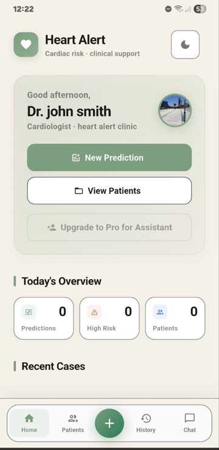
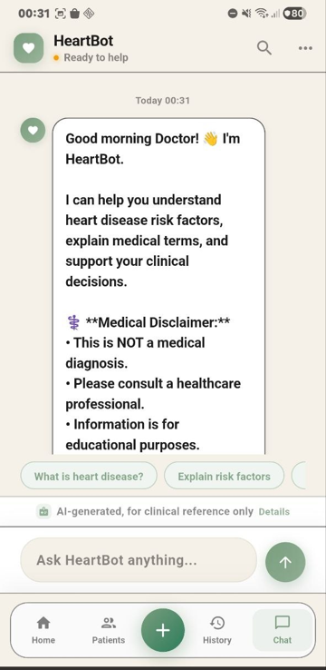
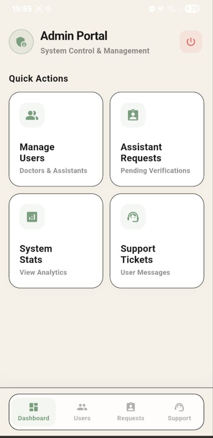
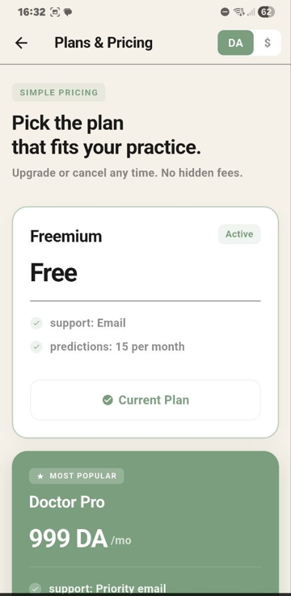

# Heart Alert, mobile app

The Flutter app of **Heart Alert**, a cardiovascular risk screening tool for doctors.
It runs on Android and in the browser, and talks to the [Heart Alert backend](https://github.com/Temroade-cmd/heart-alert-backend),
which hosts the XGBoost prediction model.

Flutter · Dart · Provider · OpenRouter

> **Medical disclaimer.** Heart Alert is a decision support prototype built for a Master's thesis.
> It is not a certified medical device and has not been clinically validated.
> Its output must never replace the judgment of a qualified clinician.

---

## Contents

- [Features](#features)
- [Screenshots](#screenshots)
- [What the app sends for a prediction](#what-the-app-sends-for-a-prediction)
- [Project structure](#project-structure)
- [Getting started](#getting-started)
- [Design](#design)
- [Limitations](#limitations)
- [Project context and team](#project-context-and-team)

---

## Features

**For doctors**
- A guided form for the 11 clinical parameters, which returns a risk score and a risk level (low, moderate, high).
- Each prediction can be exported as a PDF report, to print or share.
- History of all predictions, with search by patient name and filters by risk level.
- A patient directory to add, edit, search and delete patients.
- HeartBot, a chat assistant that receives the patient's data and risk score as context. It adds a warning when an answer talks about diagnosis, treatment or dosage.

**For assistants**
- They work on the patients and the history of the doctor they are assigned to.

**For hospital admins**
- A dashboard of the hospital, doctor invitations by email, and the list of active doctors.

**For admins**
- Review of new doctors (medical license and ID), approval or rejection, user and assistant management, support tickets and platform statistics.

**Account**
- Signup in four steps with upload of the professional documents, then a waiting screen until an admin approves the account.
- Email verification, phone number check, and password reset by email with a deep link back into the app (`heartalert://reset-password`).
- Profile with photo, and a dark mode that is remembered between sessions.

**Plans**
- Freemium (15 predictions per month), Doctor Pro (999 DA per month) and Hospital (200,000 DA per year).
- Payment through Stripe Checkout, opened in the browser.

---

## Screenshots

<p>
  
  
  
  
</p>

---

## What the app sends for a prediction

The form in `lib/screens/prediction_screen.dart` turns each choice into a number before calling `POST /predict`.

| Field | Form choice | Value sent |
|---|---|---|
| `sex` | Male, Female | 1, 0 |
| `cp` | Typical angina, Atypical angina, Non-anginal pain, Asymptomatic | 0, 1, 2, 3 |
| `fbs` | ≤ 120 mg/dl, > 120 mg/dl | 0, 1 |
| `restecg` | Normal, ST-T abnormality, LV hypertrophy | 0, 1, 2 |
| `exang` | No, Yes | 0, 1 |
| `slope` | Upsloping, Flat, Downsloping | 0, 1, 2 |

Age, blood pressure, cholesterol, maximum heart rate and ST depression are sent as typed.
This is the Cleveland coding used in the thesis. The backend converts `cp` and `slope` to the coding of its training data.

---

## Project structure

```
lib/
  main.dart                 entry point, deep links, theme and first screen
  config/app_config.dart    backend URL (development or production)
  screens/                  one file per screen (doctor, assistant, hospital, admin, auth)
  services/
    api_service.dart        every HTTP call to the backend
    token_service.dart      stores the access and refresh tokens
    patient_service.dart    patient requests
    pdf_service.dart        PDF report of a prediction
    chatbot_service.dart    HeartBot, with its prompt, validator and small medical glossary
    file_upload_service.dart, web_upload_service.dart   document upload on mobile and web
  providers/                auth and theme state (Provider)
  models/                   doctor, user, prediction, chat message
  theme/                    colors, text styles, light and dark themes
  utils/                    routes, email validation, responsive helpers
  widgets/                  shared widgets
android/                    Android project
assets/                     images and app icon
```

---

## Getting started

You need the Flutter SDK (Dart 3), and an Android emulator, a phone, or Chrome.

```bash
git clone https://github.com/Temroade-cmd/heart-alert-frontend.git
cd heart-alert-frontend
flutter pub get
```

Create a `.env` file at the root. It is declared as an asset in `pubspec.yaml`, so the build fails if it is missing.

```bash
CHATBOT_API_KEY=your_openrouter_key
```

The backend URL is set in `lib/config/app_config.dart`.
`main.dart` selects the production backend on Render. To use a backend running on your machine,
set `AppConfig.flavor = Flavor.development;` there, which points the Android emulator to `http://10.0.2.2:8000`.

```bash
flutter run                  # on an emulator or a phone
flutter run -d chrome        # in the browser
flutter build apk --release  # Android build
flutter build web            # web build
```

---

## Design

A calm sage green palette on a cream background, with a full dark theme.

| Name | Hex |
|---|---|
| Cream | `#F5F0E8` |
| Black | `#1A1A1A` |
| Sage green | `#7A9E7E` |
| Sage light | `#A8C5A0` |
| Sage dark | `#4E7252` |
| Dark background | `#121212` |
| Dark surface | `#1E1E1E` |

---

## Limitations

- HeartBot calls OpenRouter directly from the app, with the key read from `.env`. Because `.env` is bundled as an asset, the key ships inside the app. The backend already has a `POST /chat` route, and using it would keep the key on the server.
- The chatbot model is set to `openrouter/free` in `chatbot_service.dart`. The thesis version used Gemini 2.0 Flash.
- There is no iOS project in the repository, only Android and web.
- The risk score comes from a model trained on public research data, see the limitations in the backend README.

---

## Project context and team

Heart Alert was built as a Master's thesis project (M2, Information Systems Engineering) at
Université Djillali Liabès de Sidi Bel Abbès, Algeria, in 2025/2026, within the national *Startup 1275* programme.

| Team | Supervision |
|---|---|
| Sawsen Benturquia | Mohamed Amine Nemmich, supervisor |
| Tamer Benturquia | Mahmoud Fahsi, co-supervisor |
| Abdelkader Boukhalfa | Asmaa Boudali, co-supervisor |
| Yazid Bessadet | |
